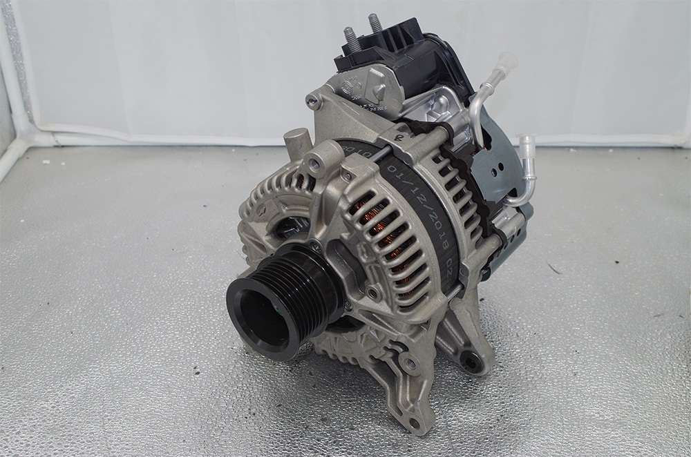

# Starter Generator Controller

A WIP firmware to control a 48V belted starter generator (BSG) out of a Mercedes MHEV.  

Notice: **This project is provided as is and is not intended to be a beginner-friendly tutorial.**  
I've tried to document most of my findings, but it assumes a basic understanding of STM32, CAN and electronics. If something is unclear and you can't figure it out by looking it up online, feel free to create an issue. Sadly I can't devote much energy to maintain projects like these, so I can't promise to reply (in a timely manner).

You can read about the process of reverse-engineering the starter generator in [this Mastodon thread](https://chaos.social/@LeoDJ/116104736115183387). I'll also post any new findings there.

I've successfully tested this code for BSGs with the part number `A 264 900 10 00`. And the two spare parts I've acquired over the last two years had the same BSG firmware version on them.

## BSG Hardware


These SEG/Bosch-made starter generators are pretty cool, as they can be acquired for a few hundred Euro as spare parts, have the inverter already on board, can be controlled via CAN and have some nice specs:

- 12.5 kW peak power
- 55 Nm peak torque
- \> 13.000 peak RPM
- ~ 10 kg
- (No reverse)

The mechanical connection is a `PK` V-ribbed pulley with 7 ribs and a diameter of roughly 56mm.

You can find a 3D scan of the starter generator in the [mechanical](/mechanical/) directory.

### Connector Pinout
The CAN connector is a `TE MCON 1.2`, 2-row, 6 position.  

Connector: TE 1-2287965-5 , Pins 7-1452671-3

Pinout when viewed from the front:

```
     ┌─┐        1: Signal GND                                     
╭────┴─┴────┐   2: N/C                                            
│ 1   2   3 │   3: 12V (Terminal "30t")                           
│           │   4: CAN L                                          
│ 4   5   6 │   5: CAN H                                          
╰───────────┘   6: "Crash Signal" (Terminal "30c"), stops inverter running when not connected to 12V
```

48V power is provided via the top two M8 studs. In the original wiring diagram, they are connected to 50mm² thick cabling.  
The absolute maximum voltage range appears to be 24 - 56V. But I haven't tested it extensively out of the range of 40-50V.

> [!IMPORTANT]  
> Make sure to connect the signal GND to the power GND!  
> Otherwise, the CAN communication won't work.


## Usage / [Firmware](BSG_Driver_Firmware/README.md)
See the [Firmware readme](BSG_Driver_Firmware/README.md) for the documentation on how to get this project up and running.

## FBS4 / DAS Notes
Since this starter generator can function as a starter motor, it is integrated into the FBS4 Drive Authorization System. Therefore, it won't accept any CAN commands until it has authorized itself with the electronic ignition switch.

Luckily we can also write into the memory of the starter generator via the XCP protocol. So with the knowledge gained from dozens of hours of firmware analysis, it's as simple as writing a `1` into the correct memory location.  
This method only works for this specific starter generator hardware, with a specific firmware version. **It is by no means a complete "FBS4 Bypass", nor is it intended to be.**

If the BSG firmware version doesn't match the known version, the STM32 will print an error to the USB serial connection (`ERROR: possible incompatible firmware version detected`).

In this case, please perform a firmware dump and open an issue with the dump.

## BSG Firmware Dumping
If you want to dump and/or play around with the firmware of the starter generator, I've put together [a little Python script](scripts/xcp_util.py) that can read and write arbitrary memory via XCP.

I've only tested it with a PCAN-USB adapter, but it should work with other adapters too. To see the available parameters, run `xcp_util.py --help` or look at the parameter definitions in the script.

You only need to connect 12V to pins 3 and 6, GND to pin 1 and the GND screw stud and the CAN lines to the CAN dongle. 48V is not needed.  
If it draws roughly 250mA from the 12V supply in the first few seconds after booting up, the power connection is working fine.

If running `xcp_util.py dump -s 0x0 -n 16` returns something like `01 5A 01 5A ...`, this means that everything is working.  
You can now start the full dump with `xcp_util.py dump -s 0x0 -e 0x1FFFFF -O dump.bin`.

### BSG Firmware Analysis 
For analyzing the firmware in Ghidra, you need to select the language `PowerPC:BE:64:VLE-32addr` and also [modify a few files inside the Ghidra directory](https://chaos.social/@LeoDJ/113201096531973967) for the r2/r13 offset registers to work correctly in the decompiler. 

But be warned, the code is highly auto-generated and contains huge numbers of lookups and abstractions (probably due to AUTOSAR).


## Supporting
Projects like these take huge amounts of time. If you want to enable such endeavours in the future and can spare a coin, consider supporting my efforts.

[](https://github.com/sponsors/LeoDJ)

## Bonus Content
### Maximum RPM Test
<https://github.com/user-attachments/assets/1381d043-2e05-4a8a-9768-3409e78a8699>

In this clip it reached a peak RPM of 13,400.

### High Power Dyno Test
<https://github.com/user-attachments/assets/f06e74fb-11d8-4aec-9326-18f98a6d7e20>

See [this Masto post](https://chaos.social/@LeoDJ/116104736103922255) for results of this this test.

# Disclaimer
We are not affiliated, associated, authorized, endorsed by, or in any way officially connected with Bosch, Mercedes, Daimler, or any of their subsidiaries or their affiliates.

